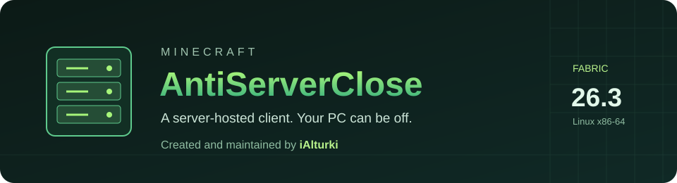
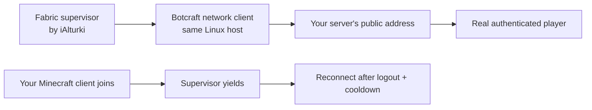

<div align="center">

<!-- AI setup by iAlturki -->
<p align="center">
  
  &nbsp;&nbsp;
  <a href="https://ialturki.github.io/Minecraft-AntiServerClose/agent-setup/"></a>
</p>
<p align="center"><sub>Click the setup button, copy the prompt, and give it to your AI agent. <a href="docs/agent-setup/prompt.txt">Read the prompt</a>.</sub></p>
<!-- /AI setup by iAlturki -->

# Minecraft AntiServerClose

**A server-hosted Minecraft client that can keep compatible idle-based hosts active.**

**Created and maintained by [iAlturki](https://github.com/iAlturki).**

[](https://github.com/iAlturki/Minecraft-AntiServerClose/releases/tag/v0.5.0-beta.1)
[](https://github.com/iAlturki/Minecraft-AntiServerClose/actions/workflows/build.yml)
[](LICENSE)

Minecraft **26.3** · Fabric **0.19.5+** · Java **25+** · Linux **x86-64**

[Setup guide](docs/SETUP.md) · [Tested behavior](docs/VERIFICATION.md) · [Troubleshooting](docs/TROUBLESHOOTING.md) · [Source builds](docs/BUILD.md)

</div>

## What it does

A small Fabric mod starts a Microsoft-authenticated [Botcraft](https://github.com/adepierre/Botcraft) client **inside your Minecraft server's Linux environment**. On a host that counts this real network connection as an online player, the server can stay active while you are away. Your PC can be off after setup.

- **One JAR to install.** The Linux client and its libraries are included.
- **Your licensed account.** Microsoft device login; no password or token pasted into configuration.
- **Disabled by default.** Set your own server address, player name, and explicit consent to server-stored credentials.
- **Yields to you.** An observed replacement session using the same account stops the bot; it reconnects after you leave and the cooldown expires.
- **Bot-session damage protection.** Protects the exact bot player entity while its child process is alive. Your replacement human session keeps normal damage behavior.
- **26.3 protocol fixes.** Corrects certificate expiry timestamps and teleport acknowledgements that otherwise send incomplete position data.
- **Clean shutdown.** Stops its child when Minecraft stops. It never blocks `stop` or force-kill signals.

## Read before installing

**This is a beta, not a promise of 24/7 hosting or compatibility with every free host.** The underlying fixes were tested on a Free Minecraft Servers Host Provider (one free-plan server) on **2026-10-12**. The public build adds configurable addresses, branding, and account-name checks; see the [validation record](docs/VERIFICATION.md) for the exact limits.

**Host policy risk:** idle-limit avoidance or automated clients may breach your provider's rules. Suspension or termination can mean losing your world. Read the provider's current terms, idle policy, and renewal/deletion deadlines before using this mod. Technical success is not permission. This mod does not renew the host's retention deadline.

**Account and world risk:** reusable Microsoft/Minecraft authentication credentials are stored on the hosting server. Anyone able to read those files may be able to reuse them. Use only an account you own and a host you trust. Make a world backup **before** testing. A dedicated account you already own is preferable; sharing your usual account means the bot uses the same saved player, position, and inventory. Protection cannot guarantee against every mod, bug, host kill, or policy action.

## Install and connect your account

1. Download [`Minecraft-AntiServerClose-26.3-0.5.0-beta.1.jar`](https://github.com/iAlturki/Minecraft-AntiServerClose/releases/download/v0.5.0-beta.1/Minecraft-AntiServerClose-26.3-0.5.0-beta.1.jar) from the [beta release](https://github.com/iAlturki/Minecraft-AntiServerClose/releases/tag/v0.5.0-beta.1). Check its SHA-256 against `SHA256SUMS.txt`.
2. Back up your world, stop the server, and upload the JAR to `mods/`. Keep **Fabric API** installed. Use Minecraft **26.3**, Fabric Loader **0.19.5+**, Java **25+**, and Linux **x86-64**.
3. Start the server once. Check that the native diagnostic passes. Edit `config/minecraft-antiserverclose/antiserverclose.properties`:

   ```properties
   enabled=true
   username=YourMinecraftName
   address=your-server.example.com:25565
   authentication-approved=true
   reconnect-seconds=90
   ```

   Use your **Minecraft Java profile name**, and the real client-facing hostname **with an explicit port**. `authentication-approved=true` means you accept reusable credentials stored on this host. Keep `online-mode=true` and your whitelist; whitelist the account if needed.
4. Save the file while your account is logged out of Minecraft. Read the fresh device-login instructions in `config/minecraft-antiserverclose/bot-console.log`. Open Microsoft's indicated verification page yourself, enter the current code, and approve the account you intend to use. Never post the code or log publicly.
5. Look for a successful real-player join in the Minecraft console. Verify it with `list`. Then perform the [idle and handover checks](docs/SETUP.md#6-verify-before-leaving-it-unattended) before relying on it overnight.

**[Full account setup, whitelist, port, rollback, and sign-out steps →](docs/SETUP.md)**

## How it works



The worker reads configuration once per second; player lookups run on the Minecraft server thread. It will not intentionally connect over an existing session using the configured name. If your human session replaces the bot, the supervisor stops the native child and waits. The bot logs in through the normal protocol and consumes a player slot; a Carpet fake player is a different mechanism.

The client includes iAlturki's fixes for two issues in the pinned Botcraft 26.3 build: fractional certificate timestamps and missing coordinates/rotation in protocol-777 teleport acknowledgements. These do not turn off Microsoft authentication or signed-profile validation. Details and source provenance: [THIRD_PARTY.md](THIRD_PARTY.md).

## Requirements and cost

| Requirement | What to expect |
|:--|:--|
| Software | Free and open source; no project subscription or paid cloud account |
| Account | An existing Microsoft account with a Minecraft Java license; acquiring another account is not free |
| Server | Fabric 26.3 on Linux x86-64; a native-compatible glibc/runtime and permission to run a child process |
| Dependencies | Fabric API, Fabric Loader 0.19.5+, Java 25+ |
| Host resources | One extra native process and one player slot; CPU/RAM usage has not been benchmarked |
| Reliability | Verified past idle thresholds on one host; outages, account expiry, network blocks, AFK rules, and host changes can stop it |

**Windows/ARM hosts, other Minecraft versions, Paper/Spigot, and other free providers have not been validated.** A mod cannot restart itself after the host kills its entire container. It cannot repair a deleted world or bypass a provider's control-plane renewal deadline.

## Build from source

On Ubuntu 24.04 x86-64 with Python 3.10+, `g++` supporting C++20, and JDK 25:

```bash
git clone https://github.com/iAlturki/Minecraft-AntiServerClose.git
cd Minecraft-AntiServerClose
python3 tools/fetch_dependencies.py
python3 tools/build_native.py
python3 build.py
python3 tools/package_sources.py
```

Dependencies are pinned and checksummed. Protocol, timestamp, account-argument, and supervisor checks run during the build. The output is in `dist/`. [Build details and Windows/WSL instructions](docs/BUILD.md).

## Credits and license

**Minecraft AntiServerClose — © 2026 [iAlturki](https://github.com/iAlturki).** Created and maintained by iAlturki. Keep these project credits when redistributing.

GNU **GPL v3**: [LICENSE](LICENSE), [NOTICE](NOTICE), and [AUTHORS](AUTHORS). Botcraft and its dependencies retain their original third-party attribution and license notices. Each release includes corresponding source; read [THIRD_PARTY.md](THIRD_PARTY.md). This project is independent of Mojang, Microsoft, Fabric, Botcraft, and hosting providers.

<p align="center"><sub>Made by <a href="https://github.com/iAlturki"><b>iAlturki</b></a> · <a href="CHANGELOG.md">Changelog</a> · <a href="SECURITY.md">Security</a></sub></p>


The independent [AI setup page and prompt](docs/agent-setup/) are **CC BY-NC-SA 4.0 © iAlturki**. The mod, client, protocol fixes, and required build/source components remain **GPL v3**; dependency notices are unchanged.
